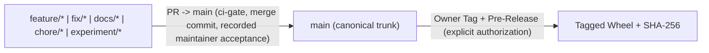

# Contributing

AI-SDLC Lite is in early development toward V1.0.0. Small documentation improvements and reports of confusing steps are useful. Keep the core beginner-friendly, tool-agnostic, and free of mandatory dependencies or services.

## Propose a bounded change

- Explain the problem, intended behavior, scope, and how the change will be checked.
- For new features, policy changes, or wider restructuring, agree on the plan with a maintainer before implementation. Use an issue or pull request when repository collaboration is available.
- Keep each change focused. Preserve existing work and avoid unrelated formatting or generated files.

Aim for one useful vertical slice with observable value, then use feedback to choose the next increment. Follow the [incremental delivery guidance](WORKFLOW.md#deliver-one-useful-increment); keep one authoritative task brief and one result record, reusing relevant context and still-valid evidence. Match checks to risk and maturity. A verified PoC, Prototype, or Pilot does not establish production readiness.

## Prepare for review

Read [README.md](README.md) and follow its two human gates and outcome definitions. AI assistance is welcome; the contributor remains responsible for accuracy, rights, and verification. Disclose material AI assistance in the change description without uploading private prompts or transcripts.

For documentation changes, check Markdown headings, code fences, local links, terminology, and consistency with the project status. Check external references when changing claims about them. For future code or examples, run the documented deterministic checks and report commands and actual results. State what was not tested and why. Do not claim compatibility based only on a tool's documentation.

Include the problem solved, resulting behavior, validation evidence, and remaining limitations in the review description. A maintainer must explicitly accept the reviewed revision. Acceptance does not independently authorize publication or release.

For GitHub contributions, follow the [optional task-to-merge mapping](WORKFLOW.md#optional-github-mapping). Link the task and result in the PR rather than duplicating them. PR and merge permissions follow repository rules and explicit authorization; an existing approval need not be repeated. Local contributions do not require GitHub.

## Branch & Release Governance (D04)

Current state (hosted settings read on 2026-11-27; they can change): `main` is the GitHub default branch and the single canonical trunk (OD-24, OD-26). A repository ruleset (id 28257917, active) targets `main` only and requires a pull request (zero approving reviews) and the `ci-gate` check (strict), blocks non-fast-forward updates and deletion, and has no bypass actors. Merge commits are the only enabled merge method, repository-wide. Secret scanning and push protection are enabled. The legacy branches `master` and `develop` are frozen and retained (OD-30): a second active ruleset (id 28258852) targets both, restricts updates, blocks deletion and non-fast-forward updates, and has no bypass actors. Their earlier classic protection (a pull request and `ci-gate`, strict; administrators are not bound) is preserved. While frozen, the content of `master`, including the file served by its raw installation URL, cannot change. These are configuration facts verified by read-back; direct-push, force-push and deletion rejection have not been tested. Repository administrators can still change settings, so these rulesets are controls, not impossibilities.

- **Permanent branch:** `main`. `master` and `develop` are frozen legacy branches, retained for now; eventual retirement needs the OD-30 conditions and separate authorization. No branch is deleted merely because it is stale.
- **Temporary branches:** `feature/*` (or `feat/*`), `fix/*`, `docs/*`, `chore/*`, `experiment/*` originate from `main` and target `main` (optional `hotfix/*`, `release/*` when needed).
- **Checks & merge policy:** the `main` ruleset requires a pull request and `ci-gate` (strict); use merge commits only, and retire merged branches only after verifying no stacked PR depends on them. The project's own rule is explicit maintainer acceptance (Gate 2) recorded in the pull request; GitHub's approving-review count stays at zero for the one-maintainer model, so a checklist or review click is not an authenticated approval. The ruleset also carries a GitHub-supplied setting for extra approval of unattributed changes; its behavioral effect with zero required approvals is UNKNOWN.
- **Release promotion:** tag experimental releases from `main` only after explicit owner authorization (`RG-2`/`RG-3`); immutable releases and tag protection belong to M-04 and are not enabled.
- **Emergency recovery (approved procedure, not yet exercised):** requires explicit owner authorization; a recorded reason and scope; the minimum necessary temporary settings change, never a standing bypass actor; restoration of the exact ruleset definition; an authenticated read-back against the record; and a recorded incident outcome. Live protections are not disabled to test it.
- **Accepted work and closure:** accepted work is closed only when it is synchronized with the canonical remote (see [Repository-first lifecycle](WORKFLOW.md#repository-first-lifecycle-and-closure)). Publishing commits, branches, packages, tags or releases needs explicit authorization; public visibility is not blanket authorization.
- **Commit identity and records:** use your GitHub account's noreply address for commits to this repository so personal addresses stay out of public history. Never commit credentials, personal data or absolute local paths. Restricted evidence stays outside the repository and is indexed in `docs/engineering/EVIDENCE_INDEX.csv`; essential evidence is held in a private companion repository, and restricted originals remain local under the time-limited exception in OD-36.

## Rights and conduct

Submit original work or material you have permission to contribute under the [MIT License](LICENSE). Preserve applicable notices, attribute external ideas, and identify third-party material and its license before inclusion. Do not submit proprietary code, private data, secrets, or copied vendor documentation. Contributions to original project material use the same MIT license.

Be respectful, explain technical disagreements, and focus feedback on the work. Report security-sensitive concerns according to [SECURITY.md](SECURITY.md), rather than in public issues.

Versioning policy and unreleased changes are recorded in [CHANGELOG.md](CHANGELOG.md).
