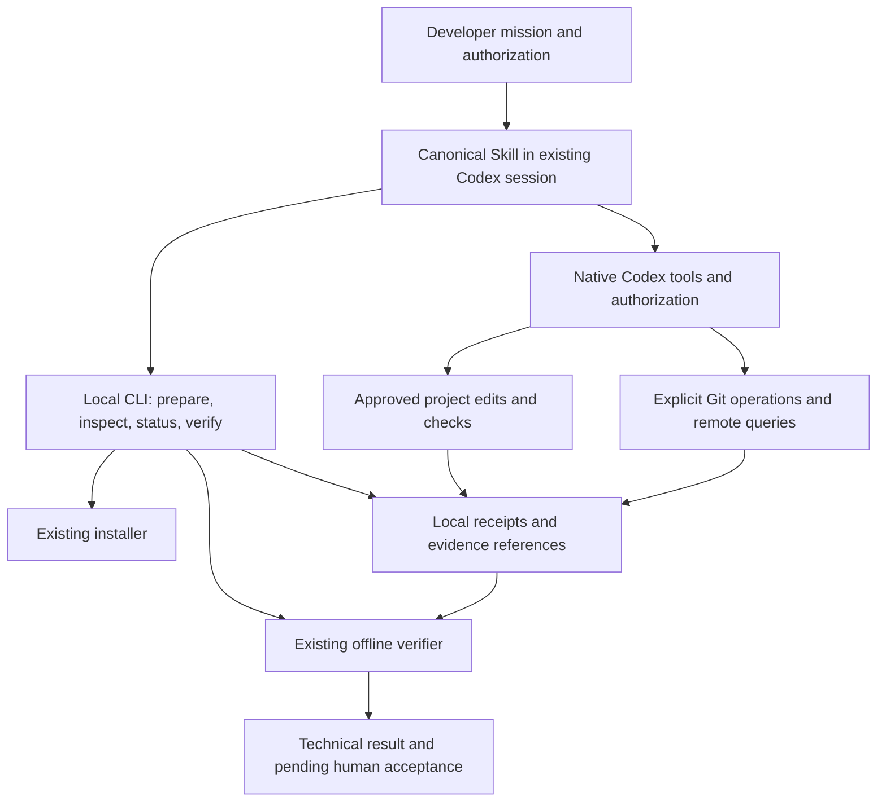

# Automation-first developer experience proposal

Status: DESIGN ONLY. This sanitized proposal describes technical interfaces and
future gates; it is not a historical execution report or approval to implement.
The local candidate descends from the existing public baseline and has no private
Git ancestry. Historical milestone identifiers remain planning identifiers.
Canonical [AGENTS.md](AGENTS.md), [WORKFLOW.md](WORKFLOW.md) and
[RESULT_CONTRACT.md](RESULT_CONTRACT.md) govern any future task.

## 1. Source audit and evidence boundaries

| Component | Source-level behavior | Limit |
| --- | --- | --- |
| [Skill](.agents/skills/ai-sdlc-lite/SKILL.md) | Canonical instructions and reusable result link | Presence is not discovery qualification |
| [Installer](scripts/install_skill.py) | Ownership manifest, link closure, repeat checks and guarded uninstall | Runtime readiness checks Copilot |
| [Codex adapter](adapters/agents/codex/README.md) | Exact-version declaration validation | No live execution or authority |
| [Verifier](scripts/verify_scope.py) | Offline post-execution scope and evidence checks | Hashes do not prove independent execution |
| [Technical reference](docs/qualification/CODEX-002-summary.md) | Template and adapter interfaces | No private report dependency |

Native Git and network requests remain subject to the current host's permissions.
This proposal establishes no intervention, duration, token-saving or unattended
qualification result. Private execution reports are intentionally excluded.

## 2. Friction inventory

Counts are not reconstructed from remembered prompts. Each item has a proposed remedy and a remaining boundary.

| ID | Friction and observed source | Minimal remedy | Remaining boundary / validation |
| --- | --- | --- | --- |
| F01 | Owner repeats session/setup context | Resolve one authoritative mission and emit a small capability summary | Missing authorization cannot be invented |
| F02 | Task pointers, templates and historical reports can be confused | Reuse existing context pointer; name task/result paths; protect prior bytes | A pointer is not approval |
| F03 | Copilot-oriented installation is mistaken for Codex readiness | Separate bundle integrity from agent-specific discovery receipts | Fresh Codex smoke required |
| F04 | Static config said never while effective session was on-request | Doctor records declared, effective and observed facts separately | No authoritative effective API means UNKNOWN and execution stop |
| F05 | Commits fail on protected .git, despite project scope approval | Detect metadata boundary and prepare one exact native Git request | Native host may still require approval or deny |
| F06 | Remote checks incur extra operational approval | One explicit remote query per gate; reuse within unchanged delivery state | Requery immediately before push and after delivery |
| F07 | Combined Python verification mixes local assertions and SSH | Separate offline assertions from direct native network commands | Never tunnel an unauthorized operation through a wrapper |
| F08 | Repeated inventory reads, full diffs and verbose test output consume context | Compact summaries with paths/hashes; bounded error excerpts; archive full evidence | Revalidate changed inputs; do not hide failures or omit required checks |
| F09 | Known authorized work stops after planning or intermediate success | Skill follows remaining approved phases through verify and delivery | Scope growth and native denial still stop affected work |
| F10 | Recovery requires rediscovering completed steps | Append receipts and resume from last verified state | Commit/push uncertainty requires reconciliation, never blind replay |
| F11 | Broad staging risks committing historical evidence | Compare index paths and blob hashes to approved inventory before commit | No git add -A, implicit evidence inclusion or auto-clean |
| F12 | No clear intervention/token accounting window | One run identifier and source-tagged metrics | Missing or incomplete telemetry is UNKNOWN |

## 3. Architecture and ownership

The existing offline core remains unchanged. The proposed CLI is a small deterministic interface used by the developer's existing agent session. It prepares and checks facts; Codex remains the sole agent and uses its native tools for edits, approved project checks and Git delivery. There is no background worker or second agent loop.

Proposed implementation: `python3 -m ai_sdlc` from a reviewed local checkout, stdlib Python plus existing Git/Codex; optional shell command alias is a later packaging decision. Nothing is installed globally by default. Code must not import project modules, evaluate shell strings or execute commands from JSON. Use bounded argv invocations and the verifier's reviewed Git-reading mitigations where applicable.

The CLI cannot mediate native approval in an arbitrary subprocess. It must not execute a blocked commit or SSH command in a parent process, switch interpreters, clone elsewhere, copy .git, drop policy, or launch another session to evade a denial. If a native integration cannot request the required authorization, record BLOCKED and the exact pending operation. No generic shell/interpreter grants.

### Skill versus CLI

| Skill owns | Local CLI owns | Native host / owner owns |
| --- | --- | --- |
| Interpret request; inspect project instructions; propose missing task details | Parse explicit paths/mission data; validate shape and required fields | Approve task scope and exceptional actions |
| Reuse original approval; finish all authorized phases without routine reconfirmation | Snapshot repository facts and protected evidence references | Effective sandbox, operational approval and credentials |
| Choose relevant checks from approved plan; act through native tools | Deterministic inventory, installer reuse and verifier delegation | Actual prevention of unauthorized writes/network |
| Explain failures and concrete stop/recovery needs | Status receipts, input freshness, summaries and metric attribution | Independent observation/custody and human acceptance |

No duplicate BOV prose or alternate approvals contract belongs in the CLI. No file hashing, staging policy engine or permission workaround belongs in a growing prompt. CLI facts remain data; untrusted project/remote content cannot grant authority.

## 4. Local CLI V1 scope

All command names here are proposals; none exists as a unified entry point today.

| Proposed command | V1 responsibility | Side effects |
| --- | --- | --- |
| `doctor --repo PATH --agent codex --json` | Report root, HEAD, dirty/index inventory, tool versions, Skill integrity, hooks/signing declarations, capability provenance and required next gates | Offline, read-only; no remote/authentication probe; no inference |
| `init --repo PATH --agent codex --dry-run` | Delegate existing bundle preview; distinguish delivery integrity from agent discovery | Preview default; explicit apply later uses existing ownership/consent controls |
| `prepare --repo PATH --mission PATH` | Validate an existing explicit brief/plan, compute digest and emit compact native operation plan | No execution or approval invention; writes new receipt only to an approved evidence directory |
| `status --run PATH --json` | Describe last confirmed state, stale inputs and pending native operation | Read-only; no inferred success from missing logs |
| `verify --repo PATH --result PATH ...` | Thin adapter to existing baseline/seal/verify/codes interfaces | Same offline semantics and exit codes; new output files only when explicitly requested |

DX-002 implements only the first vertical slice: entry point, offline doctor, verifier passthrough and read-only status. Installer integration and mission preparation follow separately. V1 does not add a `run` that evaluates contract commands, arbitrary subprocess execution, remote backend or automatic Git writer. The existing Skill can complete authorized E2E work using the prepared plan and native tools; a launcher is not necessary for that.

A natural-language developer request is the preferred entry: “Use AI-SDLC-Lite; complete mission X through local commit and push to repository Y/develop; use these files/checks and budget.” This can supply both plan and action authority if concrete enough. The agent runs available CLI steps itself; the owner need not type each command. If details are insufficient, inspect first and ask once for the missing bounded decision. One request is a target, not a guarantee that native prompts disappear.

Receipt format proposal `ai-sdlc-dx-run/1` is separate from existing result schemas: run id, canonical repository path, baseline SHA, mission revision/digest, original approval reference, input hashes, selected intent profile, effective capabilities with source, last verified state, completed action receipts, pending operation and metrics. Store it in a task-owned external directory approved during preflight; do not invent another required project config directory. Existing `.ai-sdlc-lite/task-context.json` remains the optional pointer; the planned `.ai-sdlc/project.json` location is not silently adopted.

New receipts are appended using exclusive file creation; a single process owns a run, and concurrent writers fail closed. Resume reconstructs state from receipts; malformed/truncated records block. Evidence and receipts writable by the agent are agent-reported, even if hashed. A trusted independent capture path must be separately established before any custody claim. Avoid retaining raw prompts, credentials or private transcripts.

## 5. Permission profiles

These are intent manifests, not security sandboxes or native configuration files. They intersect task authority, native capabilities and repository policy. Selection never grants execution rights. They are independent of existing Quick/Standard/Strict verification behavior.

| Profile | Intended operations | Native settings proposal | Default exclusions |
| --- | --- | --- | --- |
| Read-only | Local inspect, doctor, status and offline verify | Read-only sandbox; on-request approval; user reviewer | Project edits, network, inference launch, staging, commit and push |
| Local development | Approved file edits, reviewed project checks; stage/commit only if explicitly authorized in mission | Workspace-write; on-request; user reviewer; no added roots by default | Network delivery, dependency installation, destructive recovery, unrelated files |
| Authorized GitHub delivery | Local profile plus exact approved remote/owner/repository/branch, intended commits and permitted delivery action | Same sandbox and on-request approval; each required native network/Git boundary handled normally | Force, merge, protected-branch overwrite, release/deploy, credential/config writes |

“No network” and “allowed paths” in a manifest are declarations until the native host enforces them. Read-only doctor must separate writable evidence output from a read-only target; lack of evidence-directory authority blocks receipt creation, not an ordinary stdout audit. Hooks and signing are inspected; delivery honors them. The verifier's hardened read calls must not be repurposed to disable hooks/signing on commits.

Official OpenAI documentation distinguishes sandbox access from approval policy and documents workspace-write with on-request approval. This supports the proposed local-development starting point; it does not prove this host's effective permissions. See [Sandbox](https://learn.chatgpt.com/docs/sandboxing), checked 2026-11-13. [CLI reference](https://learn.chatgpt.com/docs/cli/reference) documents current options; installed-version support must be checked before any future invocation.

Global config is never changed by default. No bypass, full-access mode, automatic-review activation or persistent remembered rule is part of V1. Automatic review may incur extra usage and is excluded pending separate owner approval and version-specific evaluation. `never` is not a way to overcome protected paths. Missing native approval support yields BLOCKED, not a switch to another execution route.

Record effective settings from a supported current-session source where available; static user config alone is not authoritative. Avoid broad session-log scans; use only the current run's necessary sanitized metadata with authorized access. For execution, unknown effective boundary, credential identity or policy causes a stop. Pure audits can finish with UNKNOWN fields without pretending readiness.

## 6. E2E mission lifecycle

Technical status, progress state and human acceptance are separate fields. Existing verifier exits remain 0 PASS, 1 PARTIAL, 2 BLOCKED. Progress states below do not change those meanings.

| State | Gate/action | Next or recovery |
| --- | --- | --- |
| RECEIVED | Resolve original request, repository and instructions; record excluded existing work | INSPECTED; ambiguous target -> NEEDS_SCOPE |
| INSPECTED | Capture baseline, index, evidence hashes and relevant capabilities; identify exact checks and end boundary | AUTHORIZED if existing brief suffices; otherwise NEEDS_SCOPE |
| NEEDS_SCOPE | One concise missing decision tied to revision; no dependent action | Resume after explicit decision; unaffected read-only work may continue |
| AUTHORIZED | Bind approved revision/digest, file scope, commands and delivery destination | WORKING; changed inputs invalidate affected authority |
| WORKING | Agent edits/checks through native tools; emit receipts; complete approved phases | LOCAL_VERIFIED or CHECK_FAILED / WAIT_NATIVE |
| WAIT_NATIVE | Present the concrete exact action at native boundary | Continue after native approval; denial/unavailable -> BLOCKED |
| CHECK_FAILED | Preserve failure and attempts; correct only within approved plan | Recheck affected state; stop after original plus two unsuccessful retries |
| LOCAL_VERIFIED | Checks and offline verifier support result; inspect final diff/index | Commit/delivery if expressly authorized; otherwise REPORTED |
| COMMIT_VERIFIED | Native commit succeeded; separately check SHA, parent, paths, preserved files and status | REMOTE_PREFLIGHT if push authorized; otherwise REPORTED |
| REMOTE_PREFLIGHT | Direct native remote query; exact destination/ownership, intended range, secret/evidence review, branch policy | DELIVERING; divergence, uncertainty or policy denial -> BLOCKED |
| DELIVERING | One normal exact-refspec push through native authorization | REMOTE_VERIFIED only after separate direct query confirms SHA |
| REMOTE_VERIFIED | Receipt pins remote ref to verified local SHA; protected refs preserved | REPORTED |
| INTERRUPTED | Missing completion receipt, timebox expiry, process interruption or lost tool response | Reconcile actual state; do not replay writes |
| BLOCKED | Name unmet gate, evidence, preserved state and smallest owner/external action | Resume only when condition is resolved and authorization still applies |
| REPORTED | All authorized phases complete or explicitly partial/blocked; technical result and limitations | Stop; human acceptance PENDING until explicit reviewed-snapshot decision |

Local verification uses offline helpers. Remote verification uses a direct native `git ls-remote` request or an already authorized supported connector, with its own receipt. Never bury SSH/network operations in a Python assertion script; transport errors must not masquerade as test failures.

Before staging, require exact approved path/blob inventory and preserve unrelated staged work; stage only named files. If unrelated staged changes cannot be safely separated without altering owner work, stop instead of resetting/stashing. Immediately before commit, revalidate indexed blobs; immediately before push, recheck remote identity, HEAD, commit range and changed inputs. Existing protected branches are never overwritten by this design. Unexpected local/remote develop divergence stops for integration review.

Receipts bind each successful check to relevant source/config/script hashes, environment and revision. Reuse only when those inputs remain valid; do not rerun full suites merely because a permission prompt occurred. Unknown dependencies invalidate reuse. Native checks themselves may execute hooks/project code; inspect and authorize them rather than infer safety from their command names.

Resume is read-only reconciliation first. If a commit response was lost, inspect HEAD, parent, paths and reflog as authorized; do not create another commit automatically. If push response was lost, query the exact remote ref before deciding anything. An exact match can establish delivery; a different SHA or unreachable remote is not success. No reset, clean, stash, deletion, forced update or checkout-based recovery. Do not take a new baseline to conceal an incomplete run or dirty state.

Dirty baselines retain the existing verifier's PARTIAL ceiling. If technical PASS requires clean attribution, request a separately authorized disposable workspace before work; never silently move existing changes. Hashing alone does not make an agent-created baseline independent. Advisory timebox expiry prevents new work; report any running operation and use only a demonstrated safe completion/cancellation procedure.

## 7. Metrics and efficiency criteria

Measure completed outcomes before optimizing prompts or tokens. Collector and run identifiers must be explicit; no hosted telemetry is required.

| Metric | Definition and attribution |
| --- | --- |
| Developer interventions | Count initial request, missing-scope decisions, repeated BOV requests, native approvals/denials, manual commands, credential/session setup and recovery separately; count actions, not chat messages |
| Complete intervention count | Requires full operator/native UI coverage; otherwise UNKNOWN with any partial count labeled |
| Verified completion | Criteria met/total, verifier outcome, requested end boundary reached, local commit/remote equality receipts; report blocked and incomplete runs in denominator |
| Native token categories | Source-reported input, cached input, output/reasoning only as defined by source; do not double-count subsets or sum overlapping totals |
| Task tokens | Valid same-session cumulative difference only with matched start/end and no reset/mixed work; include reporting boundary or label partial; otherwise UNKNOWN |
| Duration | UTC start/end plus monotonic elapsed where collected; separate active intervals, native wait, owner wait and tool time without overlapping totals |
| Retries | Attempts by named operation and cause; original failure retained, retries never relabeled fresh work |
| Billed units / money | Separate provider sources, coverage, currency and actual charges; never derived from token counts |
| Context overhead | Bytes/lines of repeated material and cache hits keyed by inputs, if observed; no conversion into model tokens without native evidence |

Pilot acceptance targets: zero owner-run Git commands for an authorized successful fixture; no repeated BOV approval for unchanged scope; every authorized phase completed or given an explicit stop reason; zero security/evidence gates skipped. Native prompt reduction has no numerical promise. Compare several matched fixtures under identical versions/policies/checks and report interventions, full token windows, elapsed distributions and verified completion together; include failures. No savings or C11-B claim follows from the design or a single run.

## 8. Acceptance criteria for implementation proposals

| ID | Required demonstration before claim |
| --- | --- |
| AC01 | Doctor/status perform no target writes, network, project code or inference; unknown settings are labeled and execution readiness fails closed |
| AC02 | Unified verify preserves existing schemas, trust language, golden outputs and exit codes; does not run recorded commands |
| AC03 | Install preview/repeat/uninstall preserve target instructions, history and edited/unowned files; Codex discovery has a separate fresh-session runtime receipt |
| AC04 | One explicit mission supplies scope/action approval; unchanged scope causes no extra BOV prompts; absent commit/push authority blocks those actions |
| AC05 | Protected .git and network failures surface the exact native boundary; denial cannot trigger an alternate route or broader profile |
| AC06 | Local assertions and direct remote calls have distinct receipts; unreachable/unknown remote cannot be reported delivered |
| AC07 | Native commit includes exactly approved blobs; SHA/parent/path checks preserve sentinel, unrelated index/worktree state and master |
| AC08 | Ordinary exact-refspec delivery checks identity, range, evidence/secrets and remote SHA; divergence/protected overwrite stops |
| AC09 | Interrupted commit/push, truncated receipt and concurrent-run fixtures reconcile safely with no duplicate writes or destructive cleanup |
| AC10 | Missing telemetry remains UNKNOWN; prompt counts require UI coverage; costs and token categories remain separate |
| AC11 | No new dependency/global config; no paid run or permissions changes without named authorization; existing suite and affected installer/verifier tests remain green |
| AC12 | Clean disposable E2E fixture reaches its authorized end state; planted scope/evidence violation is BLOCKED; dirty fixture never upgraded to PASS |

These are future gates, not tests performed by DX-001. Synthetic tests precede live qualification. No public support or unattended-install claim before version-specific runtime evidence and owner acceptance.

## 9. Additive roadmap and owner decisions

| Slice | Deliverable / dependencies | Exit gate and owner boundary |
| --- | --- | --- |
| DX-001 | This design and additive roadmap | Documentation checks; proposal acceptance pending |
| DX-002-LOCAL-CLI | Minimal module, offline doctor, verify passthrough, status; reuse S08/S09 and existing core | Deterministic no-write/no-network fixtures, preserved verifier outputs; owner approves exact files and CLI interface before coding |
| DX-003-INSTALL | Reuse installer preview/apply/integrity, explicit agent discovery receipt; relates S11/S14 | No duplicate installer; Codex fresh-session smoke coordinated with CODEX-003 and separately approved inference budget |
| DX-004-MISSION | prepare/receipts, one-request Skill integration and safe resume | AC04/05/09/10; no arbitrary executor; owner approves receipt schema/custody |
| DX-005-DELIVERY | Skill/native Git operation templates and separate remote receipts | AC06/07/08/12; disposable GitHub repo/branch and publication authority required; no direct CLI policy bypass |
| DX-006-MEASURE | Matched pilot and docs/CI follow-up | AC10 and complete denominators; CI changes separately authorized; unattended qualification remains separate |

DX-002 can proceed as a deterministic local usability slice after owner approval. Live Codex work still depends on CODEX-003; this track neither closes CODEX-004 nor changes any Godot/FOB/Studio prerequisite. No previous milestone is renumbered, marked complete or reprioritized implicitly. The new delivery intent is an opt-in agent workflow outside the offline CLI; no existing prohibition on network or contract-command execution in the core is relaxed.

Decisions requested for the next mission: accept the small V1 subset and module invocation (D1), preserve Standard behavior while adding orthogonal intent profiles (D4), approve external receipt paths and custody, and select exact synthetic fixtures. No change to D5 (verifier never executes checks). Runtime versions, credentials, native integration, inference budget and any GitHub fixture publication need separate explicit scope. This document asks for design review; it does not request any permission setting change.

NEXT: DX-002-LOCAL-CLI. OWNER_APPROVAL_REQUIRED: YES.
