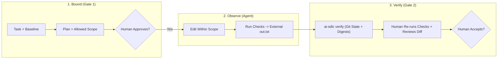

# AI-SDLC Lite

**Bounded Bound → Observe → Verify (BOV) workflow, Skill, and offline verification CLI for AI coding agents.**

[](https://github.com/mmontielpz/ai-sdlc-lite/actions/workflows/ci.yml)
-orange)


AI coding agents can drift out of scope, edit tests or governance files silently, or report success without verifiable evidence. **AI-SDLC Lite** keeps every change bounded, inspectable, and human-approved using only Python 3.9+ stdlib and Git—no daemon, database, network call, or SDK lock-in.

---

## What It Provides

- **Offline CLI (`ai-sdlc`):** `init`, `doctor`, `status`, `baseline`, `result-template`, `verify` (`PASS` / `PARTIAL` / `BLOCKED`), `seal`, `delivery`, `adapter`, and experimental `experience` journal capture/validation.
- **Agent Skill Bundle (`.claude/skills/ai-sdlc-lite/` & `.agents/skills/ai-sdlc-lite/`):** Instruction-only Markdown contracts (`AGENTS.md`, `WORKFLOW.md`, `TASK.md`, `CHECKLIST.md`, `templates/RESULT.md`) installed and hash-checked offline.
- **Honest Trust Semantics:** Separates agent assertions (`T0`), digest checks (`T1`), and tool-observed Git state (`T2`) from independent human execution and acceptance (`Gate 1` & `Gate 2`).

## BOV Conceptual Workflow (D01)



---

## Quickstart (Offline Wheel Install)

Build the wheel once from a reviewed checkout (requires `setuptools`), then install offline in any Python 3.9+ virtual environment:

```bash
python3 -m pip wheel --no-build-isolation --no-deps -w dist .
sha256sum dist/ai_sdlc_lite-*.whl

python3 -m venv .venv
. .venv/bin/activate
pip install --no-index --no-deps /path/to/ai_sdlc_lite-*.whl
ai-sdlc --version
ai-sdlc doctor
```

Initialize a target repository (standard repo or linked Git worktree) for **Claude Code**:

```bash
ai-sdlc init --repo /path/to/repo --target claude-code --apply
ai-sdlc init --repo /path/to/repo --target claude-code --check
```

Safe lifecycle management: use `--upgrade` to replace an intact older bundle, or `--uninstall` to remove only unmodified manifest-verified files. See `docs/QUICKSTART.md` for the full 5-minute walkthrough and `examples/first-five-minutes/README.md` for a disposable `PASS` / `BLOCKED` fixture.

---

## Representative First-Task Workflow

```bash
# 1. Record pre-task baseline outside the repository
ai-sdlc baseline --repo /path/to/repo --out /safe/place/baseline.json

# 2. Agent implements approved plan and writes test output to /safe/place/out.txt
# 3. Generate and populate fail-closed result contract
ai-sdlc result-template --repo /path/to/repo --out /safe/place/result.json --baseline-record /safe/place/baseline.json

# 4. Verify scope, dirty baseline preservation, and evidence digests
ai-sdlc verify --repo /path/to/repo --result /safe/place/result.json \
  --baseline-record /safe/place/baseline.json --format summary
```

At **Gate 2**, the human operator independently re-runs the required checks, inspects `git diff`, and accepts or rejects the reviewed snapshot.

---

## Supported Agents & Observed Qualification

| Target | Status | Evidence |
|---|---|---|
| **Claude Code (`2.1.329`, Linux)** | **Experimental Smoke PASS** (operator-orchestrated) | Native Skill discovery under `.claude/skills/ai-sdlc-lite/`, BOV, Experience capture, negative control (`BLOCKED`), `--uninstall`. Independent human clean-room (`G3`/`G10`) **PENDING**; deep **NOT RUN**. |
| **Linux (`ubuntu-24.04`, Python 3.14 / 3.9+)** | **Automated Suite PASS** (`Q1`) | `743` deterministic tests across `30` modules (`BuiltWheelTests` included). |
| **macOS & Windows** | **Deferred / NOT TESTED** | Unqualified; Linux-only for current experimental phase. |
| **Codex, Copilot CLI, Antigravity** | **Not in V1–V3 scope** | Historical adapters/examples preserved ([codex-live](examples/codex-live/format_elapsed.py), [codex test](examples/codex-live/test_format_elapsed.py), [copilot-live](examples/copilot-live/clamp_int.py), [copilot test](examples/copilot-live/test_clamp_int.py)); "not verified". |

Full matrix and release gates: [QUALIFICATION_MATRIX.md](QUALIFICATION_MATRIX.md) and [QUALIFICATION.md](QUALIFICATION.md).

---

## Documentation Map

| Topic | Document |
|---|---|
| 5-minute install & verification guide | `docs/QUICKSTART.md` |
| Daily BOV workflow & micro-cycles | [WORKFLOW.md](WORKFLOW.md) |
| System architecture & trust boundaries | [ARCHITECTURE.md](ARCHITECTURE.md) |
| Result contract (`ai-sdlc-lite-result/1`) | [RESULT_CONTRACT.md](RESULT_CONTRACT.md) |
| Delivery contract & executor | [docs/DELIVERY_CONTRACT.md](docs/DELIVERY_CONTRACT.md) |
| Experimental Experience journal | `docs/EXPERIENCE_CONTRACT.md` |
| Agent contracts & templates | [AGENTS.md](AGENTS.md), [TASK.md](TASK.md), [CHECKLIST.md](CHECKLIST.md), [templates/RESULT.md](templates/RESULT.md) |
| Roadmap, vision & research | [ROADMAP.md](ROADMAP.md), [VISION.md](https://github.com/mmontielpz/ai-sdlc-lite/blob/develop/VISION.md), [RESEARCH_AGENDA.md](https://github.com/mmontielpz/ai-sdlc-lite/blob/develop/docs/research/RESEARCH_AGENDA.md), [CHANGELOG.md](CHANGELOG.md), [docs/product/README.md](docs/product/README.md) |

---

## Important Limitations

- **Post-execution detection only:** `ai-sdlc verify` detects scope and digest violations after execution; it is **not** a runtime sandbox or OS confinement boundary.
- **No automatic check execution (`T3` absent):** `verify` never executes commands named in `result.json`; humans must re-run required checks before accepting at Gate 2.
- **Human approvals required:** Gate 1 (plan) and Gate 2 (acceptance) remain explicit human decisions.
- **Platform & Experience limits:** Linux-only (`macOS`/`Windows` deferred); `ai-sdlc-experience-event/1` refuses dotted/leading-symbol `task_id`s and `record-verify` on `BLOCKED`/`PARTIAL` reports with empty `failure_reasons`.
- **No unverified claims:** No production-readiness, token-saving, or acceleration claims are established.

---

## Contributing & License

Contributions and bug reports are welcome—see [CONTRIBUTING.md](CONTRIBUTING.md) for our minimal branch policy and review expectations, and [SECURITY.md](SECURITY.md) for private vulnerability reporting. Licensed under the [MIT License](LICENSE).
