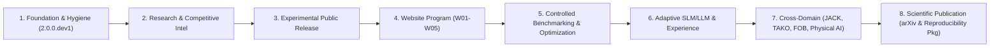

# AI-SDLC Lite — Vision & Strategic Direction

**Product Name:** AI-SDLC Lite
**Vision:** *Towards Pareto-efficient and experience-driven agentic software engineering.*
**Research Domain:** Efficient Agentic Software Engineering
**Core Methodology:** Bound — Observe — Verify (BOV)
**Design Philosophy:** Minimum Sufficient Intelligence
**Current Status:** `2.0.0.dev1` (`EXPERIMENTAL`; `Q1` PASS, `Q2` PARTIAL, `Q3` NOT_MET; `G3`/`G10` PENDING)

> **Boundary Note:** Sections below distinguish **Implemented Today** from **Future Research Directions**. Nothing in the research vision claims unverified runtime capabilities or performance gains.

---

## 1. Core Principles

1. **Product Mission:** Give developers and coding agents a lightweight, offline, deterministic control layer that keeps every software change bounded, inspectable, and human-approved.
2. **Long-Term Scientific Vision:** Establish reproducible, multi-objective engineering methods that achieve high software quality at minimal cost, latency, token overhead, and human effort.
3. **Minimum Sufficient Intelligence:** Prefer deterministic code (`L0`) over model inference, and smaller/more efficient models (`L1`–`L2`) over frontier models (`L3`) whenever deterministic checks and bounded context suffice—reserving frontier reasoning and human judgment (`L4`) for genuinely hard steps.
4. **Lightweight by Design:** Python 3.9+ stdlib and Git only; no mandatory daemon, database, cloud service, or heavyweight agent SDK.
5. **Human-Directed Software Engineering:** Humans retain explicit authority at **Gate 1** (plan & scope approval) and **Gate 2** (independent check re-run & acceptance).
6. **Deterministic Verification:** Scope, dirty-baseline preservation, and evidence digests are checked deterministically after execution; `verify` never executes untrusted project commands.
7. **Multi-Objective Optimization (Future):** Treat software delivery as a Pareto optimization problem balancing quality, cost, time, human effort, compute/tokens, and residual risk.
8. **Heterogeneous SLM/LLM Execution (Future):** Explore adaptive routing across deterministic tools, Small Language Models (SLMs), efficient LLMs, and frontier LLMs.
9. **Experience-Driven Adaptation (Future):** Use structured, privacy-preserving outcome journals (`ai-sdlc-experience-event/1`) to learn from real engineering runs without weakening safety gates.
10. **Open Science & Reproducibility:** Publish open-source tooling, frozen experimental protocols, anonymized execution evidence, and reproducible benchmark suites.

---

## 2. Six Strategic Pillars

| Pillar | Focus | Current State (`2.0.0.dev1`) | Future Direction |
|---|---|---|---|
| **Product** | Offline CLI, Skill bundle, BOV contracts | **Implemented** (`ai-sdlc` wheel, Linux) | Public experimental release → Website Program (`W01`–`W05`) → cross-domain |
| **Research** | Efficient Agentic Software Engineering | **Agenda defined** (`docs/research/RESEARCH_AGENDA.md`) | Tracks `R01`–`R08`, SLM/LLM routing, Pareto analysis |
| **Optimization** | Quality vs cost, time, tokens, risk | **Not implemented** | Multi-objective Pareto & policy optimization |
| **Benchmark** | Controlled comparisons & ablations | **Protocol planned** | Repeated-run benchmarks vs native agents, Spec Kit, OpenSpec, BMAD |
| **Intelligence** | Minimum Sufficient Intelligence (`L0`–`L4`) | **`L0` + `L4` + single-agent `L3` only** | Heterogeneous `L0`–`L4` execution & context engineering |
| **Experience** | Structured outcome capture & learning | **Local JSONL capture/validate (`EXP-01A/01B`)** | Export/analysis & evidence-driven adaptation |

---

## 3. Long-Term Product Evolution (Conceptual)

See [ROADMAP.md](ROADMAP.md) for the full 11-stage sequence and `docs/research/RESEARCH_AGENDA.md` for tracks `R01`–`R08` and benchmark methodology.
