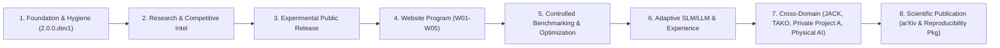

# AI-SDLC Lite — Vision & Strategic Direction

**Product Name:** AI-SDLC Lite (reference implementation)
**Research Discipline:** Efficient Agentic Software Engineering
**Long-Term Strategic Direction:** Efficient Autonomous Software Engineering (an intended evolution, **not** an achieved capability)
**Core Methodology:** Bound — Observe — Verify (BOV)
**Engineering Philosophy:** Minimum Sufficient Intelligence (MSI)
**Research Vision (unchanged):** *Towards Pareto-efficient and experience-driven agentic software engineering.*
**Current Status:** `2.0.0.dev1` (`EXPERIMENTAL`; `Q1` PASS, `Q2` PARTIAL, `Q3` NOT_MET; `G3`/`G10` PENDING) (as of 2026-11-21; authority for qualification status: `QUALIFICATION_MATRIX.md`)

> **Boundary Note:** This document separates **Implemented Today** from **Research Hypotheses** and **Long-Term Ambition**. Nothing here claims unverified runtime capabilities, performance gains, autonomous operation or standardization. Owner-defined direction is recorded in the decision register as OD-12 to OD-19 (`docs/product/OWNER_DECISION_AMENDMENTS.md`).

---

## North Star, vision, mission and goal (owner-defined, OD-12; wording as supplied)

- **North Star:** Establish an open industry standard for efficient, reliable, interoperable, and increasingly autonomous software engineering.
- **Vision:** A future where humans and AI agents collaborate to design, implement, verify, maintain, and evolve software systems with increasing autonomy, minimum necessary intelligence, and measurable engineering efficiency.
- **Mission:** Develop an open, lightweight, provider-independent, evidence-driven methodology and reference framework that advances autonomous and multi-agent software engineering through context optimization, deterministic verification, interoperable contracts, progressive autonomy, and experience-driven adaptation.
- **Product goal:** Enable developers, engineering teams, researchers, and AI agents to achieve verifiable software engineering outcomes while minimizing unnecessary token consumption, prompt engineering effort, context redundancy, computational resources, latency, human intervention, and rework.
- **Engineering philosophy (MSI):** Use the least complex and least resource-intensive combination of deterministic computation, language models, specialized agents, and human intelligence sufficient to achieve the required engineering outcome.
- **Methodology (BOV):** Establish explicit boundaries, observe execution and evidence, and verify outcomes before acceptance.
- **Strategic ambition:** Advance AI-SDLC Lite from a lightweight experimental framework into a professionally maintained open source reference implementation and, through reproducible research, interoperability, community participation, and demonstrated adoption, contribute toward an open industry standard for autonomous software engineering.

**How to read these statements.** They are direction and ambition, not achieved capabilities: no standard, standards body, certification or external adoption exists, and "increasingly autonomous" means evidence-gated and owner-approved with both human gates kept. "Provider-independent" means a provider-neutral core; qualification stays provider-specific (OD-01: Claude Code first; "supported" only with a dated VERIFIED row, `QUALIFICATION_MATRIX.md`). Quality, security, reliability, accountability and verifiability are constraints on every efficiency goal, and the reductions named in the product goal are hypotheses to measure, not results.

**Trustworthiness (OD-27).** Trustworthiness is a cross-cutting framing of this direction: the aim is efficient software engineering that humans can delegate within governed boundaries, with verifiable outcomes. It renames no accepted statement (OD-12, OD-14), changes none of `H1`–`H6`, BOV, MSI, progressive autonomy or the research hypotheses, and claims no capability.

**Bounded autonomy aspiration (OD-34).** The long-term aim is to let people delegate complex objectives to efficient, adaptive, governed and verifiable agentic systems capable of research, design, experimentation, implementation, validation and experience-driven improvement, with high levels of bounded autonomy for engineering and innovation. This is an aspiration under `H1`–`H6`, not a demonstrated capability; both human gates stay in force.

## Current position and limits

- `2.0.0.dev1`, `EXPERIMENTAL`: an offline Python stdlib CLI, the BOV Skill bundle, the deterministic verifier and the local Experience journal are implemented. Qualification status and claims: `QUALIFICATION_MATRIX.md`.
- Public distribution, release and tagging are **not currently authorized** (OD-10). The release policy (including how a Developer Preview relates to gates `G1`–`G10`) is unresolved; no qualification exception is approved, and `G1`–`G10` and both human gates stay in force.
- Initial Developer Preview audience (OD-17): developers using Claude Code on small Linux repositories. Ubuntu 24.04 LTS is the priority qualification target; Ubuntu WSL2 is deferred; Debian and Fedora are later candidates; CachyOS and Arch are observed only, never inferred as supported; macOS and native Windows are outside the immediate scope (OD-31).
- No benchmark has run; efficiency, multi-agent and autonomy statements below are hypotheses or ambition, classified in `docs/research/RESEARCH_AGENDA.md`.

---

## 1. Core Principles

1. **Product Mission:** Give developers and coding agents a lightweight, offline, deterministic control layer that keeps every software change bounded, inspectable, and human-approved.
2. **Long-Term Scientific Vision:** Establish reproducible, multi-objective engineering methods that achieve high software quality at minimal cost, latency, token overhead, and human effort.
3. **Minimum Sufficient Intelligence:** Prefer deterministic code (`L0`) over model inference, and smaller/more efficient models (`L1`–`L2`) over frontier models (`L3`) whenever deterministic checks and bounded context suffice—reserving frontier reasoning and human judgment (`L4`) for genuinely hard steps.
4. **Lightweight by Design:** Python 3.9+ stdlib and Git only; no mandatory daemon, database, cloud service, or heavyweight agent SDK.
5. **Human-Directed Software Engineering:** Humans retain explicit authority at **Gate 1** (plan & scope approval) and **Gate 2** (independent check re-run & acceptance).
6. **Deterministic Verification:** Scope, dirty-baseline preservation, and evidence digests are checked deterministically after execution; `verify` never executes untrusted project commands.
7. **Multi-Objective Optimization (Future):** Treat software delivery as a Pareto optimization problem balancing quality, cost, time, human effort, compute/tokens, and residual risk.
8. **Heterogeneous SLM/LLM Execution (Future):** Explore adaptive routing across deterministic tools, Small Language Models (SLMs), efficient LLMs, and frontier LLMs.
9. **Experience-Driven Adaptation (Future):** Use structured, privacy-preserving outcome journals (`ai-sdlc-experience-event/1`) to learn from real engineering runs without weakening safety gates.
10. **Open Science & Reproducibility:** Publish open-source tooling, frozen experimental protocols, anonymized execution evidence, and reproducible benchmark suites.

---

## 2. Strategic Pillars SP-01 to SP-06 (active model, OD-13)

| Pillar | Strategic goal | Implemented today | Research / ambition (not achieved) |
|---|---|---|---|
| **SP-01 Efficiency** | Minimum sufficient resources per accepted, verified task | `L0` deterministic verification (zero tokens); progressive-disclosure rules; `M1`–`M5` recording sheet | Quality-adjusted cost against a native-agent control, framework overhead audit (`R01`, `R02`, `R05`) |
| **SP-02 Interoperability** | Any compliant agent or tool can consume the same task, context and evidence contracts | Versioned JSON contracts; `AGENTS.md`/Skill placement; static adapter declarations (unqualified except as the matrix states) | Contract compatibility policy, second-agent observation, conformance corpus (`R07`, `R08`); no custom orchestration runtime |
| **SP-03 Progressive Autonomy** | More work delegated safely as evidence accumulates | `A1` human-directed bounded execution and `A2` micro-cycles; Gate 1 and Gate 2 | `A3`–`A5` and adaptive routing are research candidates only (table below; OD-16) |
| **SP-04 Reliability and Security** | Honest, enforceable boundaries and secure defaults | Deterministic post-execution verifier, hardened Git use, safe installer, explicit trust tiers | Secure-by-default handling of untracked content is an open candidate release blocker (see `ROADMAP.md`); threat model, release provenance |
| **SP-05 Research and Reproducibility** | Claims rest on reproducible, failure-inclusive evidence | Research agenda, benchmark protocol and controls | Pre-registered pilots and benchmarks; none run (`R01`–`R08`) |
| **SP-06 Open Standards and Adoption** | The methodology becomes independently implementable and used outside the project | MIT licence, contribution guide, reference examples | Specification, conformance, community governance, independent implementations: **ambition only** |

### Autonomy axis `A1`–`A5` (extends the existing model; separate from the `L0`–`L4` execution tiers)

| Level | Meaning | Status |
|---|---|---|
| `A1` | Human-approved single-agent bounded execution | Implemented |
| `A2` | In-scope micro-cycles within the approved plan | Implemented |
| `A3` | Multi-agent collaboration under task/result contracts with independent review; both gates retained | Research candidate (OD-16); needs evidence that it beats single-agent on quality-adjusted cost |
| `A4` | Adaptive policies and context driven by validated experience journals; policy changes need human approval | Research candidate (OD-16) |
| `A5` | Bounded autonomous execution of pre-approved low-risk task classes | Conceptual long-term; any relaxation of Gate 1 or Gate 2 is an explicit owner decision |

### How the existing research foundations map

Principles 1, 4, 6 → SP-04; 2, 3, 7 → SP-01; 5, 8, 9 → SP-03; 10 → SP-05. Tracks: `R01`, `R02`, `R05` → SP-01; `R03`, `R04`, `R06` → SP-03; `R07` → SP-02 and SP-04; `R08` → SP-05 and SP-06.

---

## 3. Historical organization (superseded as the active model by OD-13)

The six earlier pillars are preserved verbatim as the former organization; they are traceability, not active guidance.

| Pillar | Focus | Current State (`2.0.0.dev1`) | Future Direction |
|---|---|---|---|
| **Product** | Offline CLI, Skill bundle, BOV contracts | **Implemented** (`ai-sdlc` wheel, Linux) | Public experimental release → Website Program (`W01`–`W05`) → cross-domain |
| **Research** | Efficient Agentic Software Engineering | **Agenda defined** (`docs/research/RESEARCH_AGENDA.md`) | Tracks `R01`–`R08`, SLM/LLM routing, Pareto analysis |
| **Optimization** | Quality vs cost, time, tokens, risk | **Not implemented** | Multi-objective Pareto & policy optimization |
| **Benchmark** | Controlled comparisons & ablations | **Protocol planned** | Repeated-run benchmarks vs native agents, Spec Kit, OpenSpec, BMAD |
| **Intelligence** | Minimum Sufficient Intelligence (`L0`–`L4`) | **`L0` + `L4` + single-agent `L3` only** | Heterogeneous `L0`–`L4` execution & context engineering |
| **Experience** | Structured outcome capture & learning | **Local JSONL capture/validate (`EXP-01A/01B`)** | Export/analysis & evidence-driven adaptation |

**Mapping to the active pillars:** Product → SP-04, SP-02, SP-06 (websites `W01`–`W05` are evidence sources for SP-05); Research → SP-05; Optimization → SP-01; Benchmark → SP-05 and the measurement side of SP-01; Intelligence → SP-01 (MSI as decision principle) and SP-03 (routing as research); Experience → SP-03 and SP-05.

---

## 4. Long-Term Product Evolution (Conceptual; earlier flow, preserved)

Note: OD-28 places the first website pilot (`W01`) before the experimental public release. The earlier flow below is preserved; OD-38 (2026-11-28) puts W01 on hold and removes its completion as a prerequisite. The current sequence is in `ROADMAP.md`.

The active strategic horizons `H1`–`H6` and the stage mapping are in [ROADMAP.md](ROADMAP.md); research tracks `R01`–`R08`, hypotheses and benchmark methodology are in `docs/research/RESEARCH_AGENDA.md` and `docs/research/BENCHMARK_PROTOCOL.md`.
