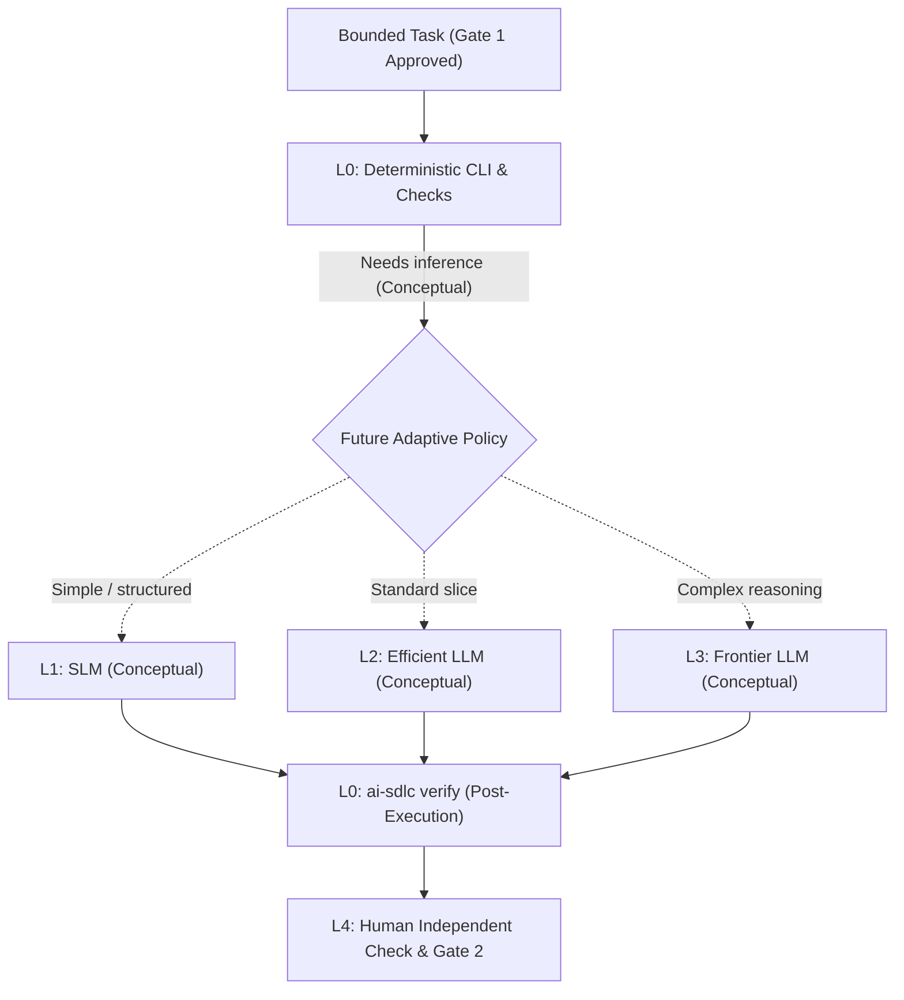
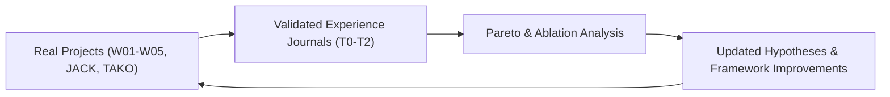

# AI-SDLC Lite — Research Agenda

**Research Domain:** Efficient Agentic Software Engineering
**Long-Term Strategic Direction:** Efficient Autonomous Software Engineering: an intended evolution, **not** an achieved capability. The research discipline above is not renamed (OD-14). Pillars: SP-01 to SP-06 in `VISION.md`.
**Status:** `RESEARCH_PLAN` (conceptual research tracks and experimental protocols; **not** implemented runtime capabilities).

---

## 1. Primary Research Inspiration

- **Belcak et al. (2025)**, *"Small Language Models are the Future of Agentic AI"*, NVIDIA Research, `arXiv:2506.02153` ([arXiv](https://arxiv.org/abs/2506.02153) · [NVIDIA LPR](https://research.nvidia.com/labs/lpr/slm-agents/)).
  - *Core thesis:* Small Language Models (SLMs) are often sufficiently powerful, operationally suitable, and economically viable for modular agentic sub-tasks, motivating **heterogeneous agentic systems** that reserve larger frontier LLMs for genuinely open-ended reasoning.
  - *Boundary:* Cited strictly as **research inspiration**, not as evidence or proof of AI-SDLC Lite performance.

---

## 2. Eight Research Tracks (`R01`–`R08`)

| Track | Title | Core Question |
|---|---|---|
| **R01** | **Efficient AI-SDLC** | How minimal can governance and BOV workflows remain while preventing scope drift and unverified claims? |
| **R02** | **Multi-Objective & Pareto Optimization** | How do workflow, context, and model choices trade off quality, cost, latency, tokens, and human effort? |
| **R03** | **Small Language Models (SLMs)** | Which bounded SDLC sub-tasks (planning lint, template filling, small fixes, test authoring) can be solved reliably by SLMs? |
| **R04** | **Adaptive Model Routing** | When should a task escalate or route across deterministic tools, SLMs, efficient LLMs, and frontier LLMs? |
| **R05** | **Context Engineering & Optimization** | How does structured BOV context reduce wasted tokens and rework without sacrificing correctness? |
| **R06** | **Experience-Driven Learning** | How can validated outcome journals (`ai-sdlc-experience-event/1`) guide safer, cheaper execution across projects? |
| **R07** | **Deterministic Governance & Verification** | Which invariants belong in zero-inference deterministic code (`verify`, `seal`, `baseline`) vs model prompts? |
| **R08** | **Cross-Domain Generalization** | How do findings transfer across Website (`W01`–`W05`), CLI (`JACK`), `TAKO`, `FOB`, and `Physical AI`? |

---

## 3. Multi-Objective Formulation (Conceptual)

### Candidate Objectives (Subject to Mandatory Safety, Governance & Acceptance Constraints)
- **Maximize:** software quality (independent acceptance pass rate, defect-free delivery).
- **Minimize:** total delivery cost (USD), execution time, human intervention count, token/compute overhead, and residual risk.

### Conceptual Decision Space & Candidate Methods
- **Decision Variables:** model selection, context configuration, agent execution strategy, verification strategy, experience reuse strategy.
- **Candidate Methods (unselected; no premature algorithm commitment):** Pareto dominance analysis, NSGA-II, NSGA-III, multi-objective Bayesian optimization, and adaptive execution policies.

---

## 4. Conceptual Heterogeneous Execution Tiers (`L0`–`L4`)

> **Disclaimer:** `L0`–`L4` are **conceptual research tiers**, not implemented runtime routing capabilities. Today AI-SDLC Lite implements `L0` deterministic tools and supports `L4` human gates with a single external coding agent (`Claude Code`).

| Tier | Layer | Role |
|---|---|---|
| **L0** | Deterministic code & tools | `ai-sdlc` CLI (`baseline`, `verify`, `seal`, `result-template`, `experience`), linters, test runners |
| **L1** | Small Language Models (SLMs) | Conceptual future tier for narrow, structured, repetitive sub-tasks |
| **L2** | Efficient Language Models | Conceptual future tier for standard implementation slices |
| **L3** | Frontier Language Models | Complex architecture, ambiguous debugging, multi-file reasoning |
| **L4** | Human Judgment & Acceptance | Gate 1 plan approval, Gate 2 independent verification & acceptance |

The `L0`–`L4` tiers (execution) and the `A1`–`A5` autonomy levels (governance; `A1`, `A2` implemented, `A3`–`A5` conceptual research candidates, OD-16) are separate axes; this agenda introduces no competing classification.

---

## 5. Benchmark Direction

- **Candidate Comparison Groups:** Native coding agents (baseline), GitHub Spec Kit, OpenSpec, BMAD Method, and other relevant OSS frameworks.
- **Mandatory Experimental Rigor:** Controlled conditions, equivalent task requirements, independent acceptance criteria, repeated runs, cost per accepted task, quality/success rate, human effort, failure & regression analysis, statistical uncertainty, Pareto frontier analysis, ablation studies, and full reproducibility. **Zero performance results are claimed or invented here.**

---

## 6. Scientific Publication Direction

- **Candidate Title:** *"AI-SDLC Lite: Towards Pareto-Efficient and Experience-Driven Agentic Software Engineering"*
- **Target Outputs:** arXiv preprint *(note: an arXiv preprint does not constitute peer-reviewed validation)*, open-source framework, reproducible experimental protocol, benchmark tasks, anonymized execution evidence, comparative results, ablation studies, and reproducibility package.

### Epistemic Classification
| Category | Meaning in This Project |
|---|---|
| **Implemented Capabilities** | Offline Python stdlib CLI (`ai-sdlc`), BOV Skill bundle, `verify`/`seal`/`baseline`, `delivery` local commit, `experience` JSONL capture/validate |
| **Observed Evidence** | `743` CI unit tests (`Q1` PASS); single operator-orchestrated Claude Code `2.1.329` Linux smoke (`Q2` PARTIAL; `G3`/`G10` PENDING) |
| **Research Hypotheses** | BOV + Minimum Sufficient Intelligence (`L0`–`L4`) + Experience feedback can improve Pareto efficiency |
| **Proposed Future Capabilities** | Adaptive routing, automated benchmarks, Experience export/analysis, `discover`/`govern check`/`task check` |
| **Demonstrated Scientific Contributions** | **None claimed yet** (pending controlled M064+ Website experiments & benchmarks) |

---

## 7. Falsifiable Research Candidates (`HY-01`–`HY-10`)

Research candidates only (OD-18). They are **hypotheses until tested**; they authorize no experiment, provider call or new instrumentation, and nothing here is a result. They extend `R01`–`R08` and the pilot metrics `M1`–`M5`, which are unchanged. Margins are not set here: they are pre-registered only after pilot variance is known, so no arbitrary efficiency target exists.

| ID | Hypothesis | Falsified if | Measure | Track |
|---|---|---|---|---|
| HY-01 token | BOV-assisted execution does not raise tokens per accepted task beyond a pre-registered margin versus the native control | margin exceeded with no quality gain | tokens, quality-adjusted cost (QAC) | R01, R05 |
| HY-02 prompt | Corrective human interventions (`M2`) per accepted task are lower with contracts than with the native control | not lower, or higher | `M2` | R01 |
| HY-03 context | Progressive-disclosure context matches acceptance with fewer input tokens than full-documents context | acceptance drops or tokens do not fall | ablation (`OPT-06`) | R05 |
| HY-04 overhead | Framework overhead (extra tokens, time, ceremony) is smaller than the measured benefit in rework and quality | overhead is not smaller than benefit | overhead versus the native control, QAC | R01, R02 |
| HY-05 QAC | The AI-SDLC Lite arm is not Pareto-dominated by the native arm on cost, time and quality | dominated on all tasks of a class | Pareto analysis | R02 |
| HY-06 multi-agent | An added reviewer or specialist agent does **not** improve QAC on tasks below a complexity threshold (null favoured; multi-agent is not assumed superior) | QAC improves beyond the margin once coordination overhead is counted | single versus multi-agent arms | R04 |
| HY-07 experience | Prior journal data lowers rework and time on later similar tasks | no effect or harm | `M3`, `M1` across sessions | R06 |
| HY-08 autonomy | A higher autonomy level lowers human active time without raising escaped defects beyond the margin | escaped defects rise | escaped defects, human time | R04, R06 |
| HY-09 interventions | Better task contracts reduce corrective (not governance) interventions | no reduction | `M2` (corrective only) | R01 |
| HY-10 reproducibility | An independent rerun of a pinned task and arm reproduces the outcome class | low agreement | agreement rate | R07, R08 |

**Reporting rules (apply to every hypothesis).** Quality-adjusted cost is computed over **all** attempts (accepted, rejected, abandoned, failed), never from successes alone, and is always reported with the acceptance rate, total resource consumption and quality outcomes; see `BENCHMARK_PROTOCOL.md` for the zero-accepted rule. Null and negative results are reported with the same prominence. Coordination overhead is part of any multi-agent result. Hypotheses and evaluation methods are pre-registered before confirmatory experiments; pilot data (for example W01) may inform later margins but is not reusable as independent confirmatory evidence without disclosure.
